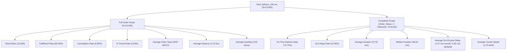

# FoodFlow Analytics — Backend Data Analysis Plan
## Metric Calculation Methodology & API Endpoint Specifications

**Project:** FoodFlow Analytics  
**Primary Dataset:** [`data/processed/food_delivery_10k.csv`](file:///c:/FoodDeliveryAnalytics/data/processed/food_delivery_10k.csv) ($N = 10,000$)  
**Target Audience:** Backend Developers, Frontend Engineers, Data Analysts  
**Document Generated:** October 3, 2026  

---

## 1. Executive Summary & Analytics Architecture

This document specifies the **backend analytics calculation engine** for the FoodFlow Analytics platform. It bridges raw order data in `food_delivery_10k.csv` with the production React + TypeScript + Vite frontend dashboard.

### Core Architectural Principles
- **Empirical Ground Truth:** All dashboard KPI cards, charts, and table metrics are dynamically computed from the actual dataset (`food_delivery_10k.csv`). Hardcoded numbers in visual mockups are treated as temporary placeholders.
- **Dual Population Filtering:**
  1. **Full Order Population ($N = 10,000$):** Used for platform demand, order status distributions (`Delivered`, `Cancelled`, `In Transit`), average order values, basket quantities, and geographic order placement.
  2. **Completed Delivery Subset ($N = 8,520$):** Used for delivery SLA metrics, fulfillment durations, courier speeds, and delay analyses (`Order_Status == 'Delivered'`).
- **Reproducible Python Engine:** Implemented via standard Pandas, Numpy, and SQL aggregation primitives.

---

## 2. Executive KPI Calculation Methodology



### Executive KPI Specification Table

| Dashboard Metric | Formula / Mathematical Definition | Scope | Calculated Value | Pandas Code Implementation | SQL Equivalent Query |
|---|---|---|---|---|---|
| **Total Orders** | $N_{\text{total}}$ | All ($10,000$) | **10,000** | `len(df)` | `SELECT COUNT(*) FROM orders` |
| **Delivered Orders** | $\sum [\text{Order\_Status} == \text{'Delivered'}]$ | All ($10,000$) | **8,520** | `(df['Order_Status']=='Delivered').sum()` | `SELECT COUNT(*) FROM orders WHERE status='Delivered'` |
| **Cancelled Orders** | $\sum [\text{Order\_Status} == \text{'Cancelled'}]$ | All ($10,000$) | **980** | `(df['Order_Status']=='Cancelled').sum()` | `SELECT COUNT(*) FROM orders WHERE status='Cancelled'` |
| **In-Transit Orders** | $\sum [\text{Order\_Status} == \text{'In Transit'}]$ | All ($10,000$) | **500** | `(df['Order_Status']=='In Transit').sum()` | `SELECT COUNT(*) FROM orders WHERE status='In Transit'` |
| **Fulfillment Rate (%)** | $\frac{N_{\text{delivered}}}{N_{\text{total}}} \times 100$ | All ($10,000$) | **85.20%** | `df['Is_Delivered'].mean() * 100` | `SELECT AVG(is_delivered) * 100 FROM orders` |
| **Cancellation Rate (%)** | $\frac{N_{\text{cancelled}}}{N_{\text{total}}} \times 100$ | All ($10,000$) | **9.80%** | `df['Is_Cancelled'].mean() * 100` | `SELECT AVG(is_cancelled) * 100 FROM orders` |
| **In-Transit Rate (%)** | $\frac{N_{\text{intransit}}}{N_{\text{total}}} \times 100$ | All ($10,000$) | **5.00%** | `df['Is_InTransit'].mean() * 100` | `SELECT AVG(is_intransit) * 100 FROM orders` |
| **On-Time Delivery Rate (%)** | $\frac{\sum [\text{Duration} \le 45]}{N_{\text{delivered}}} \times 100$ | Delivered ($8,520$) | **75.74%** | `(df_deliv['Is_Delayed_TARGET']==0).mean()*100` | `SELECT AVG(1 - is_delayed) * 100 FROM orders WHERE status='Delivered'` |
| **SLA Delay Rate (%)** | $\frac{\sum [\text{Duration} > 45]}{N_{\text{delivered}}} \times 100$ | Delivered ($8,520$) | **24.26%** | `df_deliv['Is_Delayed_TARGET'].mean()*100` | `SELECT AVG(is_delayed) * 100 FROM orders WHERE status='Delivered'` |
| **Mean Delivery Duration** | $\frac{1}{N_{\text{deliv}}} \sum \text{Duration}$ | Delivered ($8,520$) | **37.50 min** | `df_deliv['Delivery_Duration_Minutes'].mean()` | `SELECT AVG(duration) FROM orders WHERE status='Delivered'` |
| **Median Delivery Duration** | $\text{Median}(\text{Duration})$ | Delivered ($8,520$) | **38.00 min** | `df_deliv['Delivery_Duration_Minutes'].median()` | `SELECT PERCENTILE_CONT(0.5) WITHIN GROUP (ORDER BY duration) FROM orders WHERE status='Delivered'` |
| **Min / Max Duration** | $\min(\text{Duration}) / \max(\text{Duration})$ | Delivered ($8,520$) | **15 / 60 min** | `(df_deliv['Delivery_Duration_Minutes'].min(), df_deliv['Delivery_Duration_Minutes'].max())` | `SELECT MIN(duration), MAX(duration) FROM orders WHERE status='Delivered'` |
| **Average SLA Excess Delay** | $\frac{1}{N_{\text{deliv}}} \sum \max(0, \text{Duration}-45)$ | Delivered ($8,520$) | **1.37 min** (All)<br>**5.65 min** (Delayed) | `df_deliv['Delay_Minutes_TARGET'].mean()` | `SELECT AVG(delay_minutes) FROM orders WHERE status='Delivered'` |
| **Average Order Value (AOV)** | $\frac{1}{N} \sum \text{Total\_Price}$ | All ($10,000$) | **EGP 268.97** | `df['Total_Price'].mean()` | `SELECT AVG(total_price) FROM orders` |
| **Average Delivery Distance** | $\frac{1}{N} \sum \text{Delivery\_Distance\_km}$ | All ($10,000$) | **2.15 km** | `df['Delivery_Distance_km'].mean()` | `SELECT AVG(delivery_distance) FROM orders` |
| **Average Quantity per Order** | $\frac{1}{N} \sum \text{Quantity}$ | All ($10,000$) | **3.00 items** | `df['Quantity'].mean()` | `SELECT AVG(quantity) FROM orders` |
| **Average Effective Speed** | $\frac{1}{N_{\text{deliv}}} \sum \text{Delivery\_Speed\_kmh}$ | Delivered ($8,520$) | **3.75 km/h** | `df_deliv['Delivery_Speed_kmh_ANALYTICAL'].mean()` | `SELECT AVG(speed_kmh) FROM orders WHERE status='Delivered'` |

---

## 3. Operational Aggregation & Grouping Logic

For every operational group (City, Traffic, Vehicle, Distance Bin, Time of Day, Day of Week, Rush Hour, Order Value Tier), the backend analytics engine computes:

```python
def aggregate_operational_group(df: pd.DataFrame, group_col: str) -> pd.DataFrame:
    # Full dataset metrics
    all_summary = df.groupby(group_col).agg(
        total_orders=('Order_ID', 'count'),
        cancelled_orders=('Is_Cancelled', 'sum'),
        in_transit_orders=('Is_InTransit', 'sum'),
        avg_order_value_egp=('Total_Price', 'mean'),
        avg_distance_km=('Delivery_Distance_km', 'mean'),
        avg_quantity=('Quantity', 'mean')
    ).reset_index()

    # Delivered dataset metrics
    deliv_df = df[df['Order_Status'] == 'Delivered']
    deliv_summary = deliv_df.groupby(group_col).agg(
        delivered_orders=('Order_ID', 'count'),
        delayed_orders=('Is_Delayed_TARGET', 'sum'),
        avg_duration_min=('Delivery_Duration_Minutes', 'mean'),
        median_duration_min=('Delivery_Duration_Minutes', 'median'),
        avg_delay_min=('Delay_Minutes_TARGET', 'mean'),
        avg_speed_kmh=('Delivery_Speed_kmh_ANALYTICAL', 'mean')
    ).reset_index()

    # Merge & compute derived percentages
    merged = pd.merge(all_summary, deliv_summary, on=group_col, how='left')
    merged['fulfillment_rate_pct'] = (merged['delivered_orders'] / merged['total_orders']) * 100.0
    merged['sla_delay_rate_pct'] = (merged['delayed_orders'] / merged['delivered_orders']) * 100.0
    return merged
```

---

## 4. Proposed REST API Backend Analytics Endpoints

To replace the temporary visual placeholders in the React + TypeScript frontend, we propose **8 standardized REST API endpoints**.

### Endpoint 1: Summary Executive KPIs
- **Route:** `GET /api/v1/analytics/kpis`
- **Query Parameters:** `city` (optional), `date_start` (optional), `date_end` (optional)
- **Response Payload Example:**
```json
{
  "status": "success",
  "data": {
    "total_orders": 10000,
    "delivered_orders": 8520,
    "cancelled_orders": 980,
    "in_transit_orders": 500,
    "fulfillment_rate_pct": 85.20,
    "cancellation_rate_pct": 9.80,
    "in_transit_rate_pct": 5.00,
    "ontime_delivery_rate_pct": 75.74,
    "sla_delay_rate_pct": 24.26,
    "avg_delivery_duration_min": 37.50,
    "median_delivery_duration_min": 38.00,
    "min_delivery_duration_min": 15,
    "max_delivery_duration_min": 60,
    "avg_delay_duration_min": 1.37,
    "avg_order_value_egp": 268.97,
    "avg_delivery_distance_km": 2.15,
    "avg_quantity_per_order": 3.00,
    "avg_effective_speed_kmh": 3.75
  }
}
```

### Endpoint 2: Performance by City
- **Route:** `GET /api/v1/analytics/by-city`
- **Response Payload Example:**
```json
{
  "status": "success",
  "data": [
    {
      "city": "Alexandria",
      "total_orders": 1416,
      "delivered_orders": 1211,
      "sla_delay_rate_pct": 23.78,
      "avg_duration_min": 37.52,
      "median_duration_min": 37.0,
      "avg_order_value_egp": 272.27,
      "avg_distance_km": 2.11
    },
    {
      "city": "Cairo",
      "total_orders": 1439,
      "delivered_orders": 1225,
      "sla_delay_rate_pct": 24.00,
      "avg_duration_min": 37.59,
      "median_duration_min": 38.0,
      "avg_order_value_egp": 264.61,
      "avg_distance_km": 2.14
    }
  ]
}
```

### Endpoint 3: Performance by Traffic Congestion Level
- **Route:** `GET /api/v1/analytics/by-traffic`
- **Response Payload Example:**
```json
{
  "status": "success",
  "data": [
    { "traffic_level": "Low", "total_orders": 4525, "delivered_orders": 3861, "sla_delay_rate_pct": 24.14, "avg_duration_min": 37.48, "avg_speed_kmh": 3.72 },
    { "traffic_level": "Medium", "total_orders": 2551, "delivered_orders": 2162, "sla_delay_rate_pct": 25.90, "avg_duration_min": 37.89, "avg_speed_kmh": 3.77 },
    { "traffic_level": "High", "total_orders": 2924, "delivered_orders": 2497, "sla_delay_rate_pct": 23.03, "avg_duration_min": 37.21, "avg_speed_kmh": 3.78 }
  ]
}
```

### Endpoint 4: Performance by Distance Bucket
- **Route:** `GET /api/v1/analytics/by-distance`
- **Response Payload Example:**
```json
{
  "status": "success",
  "data": [
    { "distance_bin": "Short (<1km)", "total_orders": 1525, "delivered_orders": 1270, "sla_delay_rate_pct": 25.28, "avg_duration_min": 37.80, "avg_distance_km": 0.64 },
    { "distance_bin": "Medium (1-3km)", "total_orders": 6194, "delivered_orders": 5318, "sla_delay_rate_pct": 24.18, "avg_duration_min": 37.44, "avg_distance_km": 1.99 },
    { "distance_bin": "Long (3-5km)", "total_orders": 2268, "delivered_orders": 1921, "sla_delay_rate_pct": 23.74, "avg_duration_min": 37.48, "avg_distance_km": 3.59 },
    { "distance_bin": "Very Long (>5km)", "total_orders": 13, "delivered_orders": 11, "sla_delay_rate_pct": 36.36, "avg_duration_min": 38.55, "avg_distance_km": 5.16 }
  ]
}
```

### Endpoint 5: Performance by Temporal Windows (Time of Day & Day of Week)
- **Route:** `GET /api/v1/analytics/by-temporal`
- **Response Payload Example:**
```json
{
  "status": "success",
  "time_of_day": [
    { "segment": "Afternoon", "total_orders": 2118, "delivered_orders": 1798, "sla_delay_rate_pct": 25.25, "avg_duration_min": 37.68 },
    { "segment": "Morning", "total_orders": 1254, "delivered_orders": 1069, "sla_delay_rate_pct": 25.07, "avg_duration_min": 37.73 },
    { "segment": "Night", "total_orders": 1211, "delivered_orders": 1047, "sla_delay_rate_pct": 22.16, "avg_duration_min": 37.37 }
  ],
  "day_of_week": [
    { "day_name": "Monday", "total_orders": 1558, "delivered_orders": 1309, "sla_delay_rate_pct": 22.15, "avg_duration_min": 37.22 },
    { "day_name": "Wednesday", "total_orders": 1371, "delivered_orders": 1179, "sla_delay_rate_pct": 26.04, "avg_duration_min": 37.72 }
  ]
}
```

### Endpoint 6: Courier Vehicle Performance
- **Route:** `GET /api/v1/analytics/by-vehicle`
- **Response Payload Example:**
```json
{
  "status": "success",
  "data": [
    { "vehicle": "Motorbike", "total_orders": 3347, "delivered_orders": 2850, "sla_delay_rate_pct": 23.19, "avg_duration_min": 37.27, "avg_speed_kmh": 3.79 },
    { "vehicle": "Bicycle", "total_orders": 3339, "delivered_orders": 2859, "sla_delay_rate_pct": 24.27, "avg_duration_min": 37.37, "avg_speed_kmh": 3.72 },
    { "vehicle": "Car", "total_orders": 3314, "delivered_orders": 2811, "sla_delay_rate_pct": 25.33, "avg_duration_min": 37.87, "avg_speed_kmh": 3.74 }
  ]
}
```

### Endpoint 7: Order Value Tier Analysis
- **Route:** `GET /api/v1/analytics/by-order-tier`
- **Response Payload Example:**
```json
{
  "status": "success",
  "data": [
    { "tier": "Budget (<100)", "total_orders": 1562, "delivered_orders": 1329, "sla_delay_rate_pct": 25.96, "avg_order_value_egp": 69.10, "avg_quantity": 1.29 },
    { "tier": "Standard (100-300)", "total_orders": 4897, "delivered_orders": 4183, "sla_delay_rate_pct": 22.83, "avg_order_value_egp": 192.29, "avg_quantity": 2.70 },
    { "tier": "Premium (300-500)", "total_orders": 2309, "delivered_orders": 1957, "sla_delay_rate_pct": 26.32, "avg_order_value_egp": 390.22, "avg_quantity": 3.93 },
    { "tier": "Luxury (>500)", "total_orders": 1232, "delivered_orders": 1051, "sla_delay_rate_pct": 23.98, "avg_order_value_egp": 599.95, "avg_quantity": 4.66 }
  ]
}
```

### Endpoint 8: Available Dashboard Filters Options
- **Route:** `GET /api/v1/analytics/filters`
- **Response Payload Example:**
```json
{
  "status": "success",
  "data": {
    "cities": ["Alexandria", "Assiut", "Cairo", "Giza", "Mansoura", "Tanta", "Zagazig"],
    "traffic_levels": ["Low", "Medium", "High"],
    "vehicles": ["Bicycle", "Motorbike", "Car"],
    "payment_methods": ["Cash", "Credit Card", "Wallet"],
    "distance_bins": ["Short (<1km)", "Medium (1-3km)", "Long (3-5km)", "Very Long (>5km)"],
    "order_value_tiers": ["Budget (<100)", "Standard (100-300)", "Premium (300-500)", "Luxury (>500)"],
    "time_segments": ["Early Morning", "Morning", "Afternoon", "Evening", "Night", "Late Night"]
  }
}
```

---

## 5. Dataset Findings, Ambiguities & Integration Strategy

### Dataset Findings & Structural Notes
1. **Constant / Single-Value Metadata Fields:** `Order_Month` (6=June), `Restaurant_Geo_Imputed` (0), `Customer_Geo_Imputed` (0), `Driver_Geo_Imputed` (0), `Same_Location_Flag` (0) are single-value constants across the 10k dataset. They provide audit trail transparency but offer zero variance for modeling.
2. **Synthetic Simulation Speed Artifacts:** In the simulation, effective travel speeds (`Delivery_Speed_kmh_ANALYTICAL`) average **3.75 km/h**, indicating that recorded `Delivery_Duration_Minutes` represents total end-to-end turnaround (order placement + kitchen prep queue + driver dispatch + travel + doorstep handoff) rather than transit speed alone.
3. **Fulfillment Population Scoping:** Always compute overall platform volume and status shares (`Delivered`, `Cancelled`, `In Transit`) on the full 10,000 orders, while computing SLA performance, duration statistics, and speed metrics strictly on completed deliveries ($N = 8,520$).

### Frontend Integration Strategy (React + TypeScript + Vite)
- **Do NOT modify React UI layouts at this stage.** The Figma layout, grid arrangement, component structure, and CSS styling will remain untouched.
- **Data Hook Layer:** In the next integration step, build custom React hooks (`useAnalyticsKPIs()`, `useCityAnalytics()`, etc.) that fetch real data from the proposed Python/FastAPI/Flask endpoints and replace static placeholder JSON constants seamlessly.
