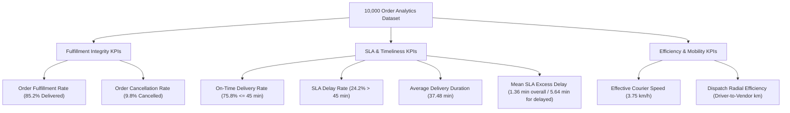

# Phase 4 Analytics Plan: Delivery Performance & Delay Analysis
## Food Delivery Analytics: Delivery Performance and Delay Prediction

**Project:** Food Delivery Analytics — Delivery Performance and Delay Prediction  
**Phase:** Phase 4 — Descriptive and Diagnostic Delivery Performance Analytics  
**Primary Dataset:** [`data/processed/food_delivery_analytics_10k.csv`](file:///c:/FoodDeliveryAnalytics/data/processed/food_delivery_analytics_10k.csv) (10,000 rows × 50 columns)  
**Report File:** [`reports/phase4_analytics_plan.md`](file:///c:/FoodDeliveryAnalytics/reports/phase4_analytics_plan.md)  
**Date:** October 3, 2026  

---

## 1. Executive Summary & Overview

Phase 4 establishes the **descriptive and diagnostic analytics roadmap** for the project. Using the representative 10,000-row analytics dataset ([`food_delivery_analytics_10k.csv`](file:///c:/FoodDeliveryAnalytics/data/processed/food_delivery_analytics_10k.csv)), this phase explores past operational performance, identifies fulfillment bottlenecks, and evaluates key factors contributing to delivery delays without training machine learning models or modifying source data.

### Scope & Constraints
- **Strict Analytical Focus:** Descriptive (what happened?) and diagnostic (why did it happen?) analytics only. No predictive modeling or ML training.
- **Untouched Source Data:** Source files remain 100% static and immutable.
- **Complete Dataset Scope:** Analyzes all 10,000 order records for fulfillment metrics (`Order_Status`), while isolating completed deliveries ($N = 8,520$) for SLA duration and delay breakdown.

---

## 2. Analytics Dataset Architecture & Field Categorization

The analytics dataset contains **10,000 rows** and **50 columns**, organized into **8 functional operational dimensions**.

### Summary of Operational Dimensions

| Operational Dimension | Column Count | Key Variables | Description |
|---|---|---|---|
| **Primary Identifiers** | 4 | `Order_ID`, `User_ID`, `Restaurant_ID`, `Driver_ID` | Entity identifiers for tracking orders, customers, restaurants, and drivers. |
| **Order & Financial** | 7 | `Item_Name`, `Quantity`, `Total_Price`, `Price_Per_Item`, `Order_Value_Tier`, `Is_Large_Order`, `Payment_Method` | Basket composition, pricing tiers, item count, and payment channel. |
| **Spatial & Distance** | 10 | `City`, `Delivery_Distance_km`, `Driver_To_Restaurant_km`, `Total_Trip_km`, `Distance_Bin`, `Restaurant_Lat`, `Restaurant_Lon`, `Customer_Lat`, `Customer_Lon`, `Driver_Lat`, `Driver_Lon` | Geographic coordinates, customer-to-restaurant distance, dispatch distance, and binned distance ranges. |
| **Fleet & Driver Status** | 3 | `Driver_Vehicle`, `Driver_Availability`, `Driver_Online` | Vehicle mode (Motorbike, Bicycle, Car) and driver system connectivity. |
| **Traffic & Congestion** | 3 | `Traffic_Level`, `Traffic_Level_Enc`, `Is_High_Traffic` | Categorical and binary traffic indicators. |
| **Temporal & Scheduling** | 11 | `Order_Time`, `Delivery_Time`, `Order_Date`, `Order_DayName`, `Order_Hour`, `Order_DayOfWeek`, `Order_DayOfMonth`, `Time_Of_Day_Segment`, `Is_Weekend`, `Is_Weekday`, `Is_RushHour` | Timestamps, hour of day, day of week, rush hour flags, and time-of-day segments. |
| **Fulfillment Status** | 4 | `Order_Status`, `Is_Delivered`, `Is_Cancelled`, `Is_InTransit` | Order completion tracking (Delivered: 8,520, Cancelled: 980, In Transit: 500). |
| **Performance & Target Metrics** | 8 | `Delivery_Duration_Minutes`, `Is_Delayed_TARGET`, `Delay_Minutes_TARGET`, `Duration_Bin_TARGET`, `Order_To_Delivery_Minutes_TARGET`, `Delivery_Speed_kmh_ANALYTICAL`, `Distance_Per_Minute_ANALYTICAL` | Core duration, delay flags (>45 min SLA), delay magnitude, speed, and analytical efficiency ratios. |

---

## 3. Concise Analytics Data Dictionary

Below is the dictionary for all 50 columns in [`data/processed/food_delivery_analytics_10k.csv`](file:///c:/FoodDeliveryAnalytics/data/processed/food_delivery_analytics_10k.csv).

| # | Field Name | Data Type | Category | Description | Sample Value / Range |
|---|---|---|---|---|---|
| 1 | `Order_ID` | `int64` | Identifier | Unique transaction identifier | `6` |
| 2 | `User_ID` | `string` | Identifier | Customer account identifier | `'U7439'` (6,048 unique) |
| 3 | `Restaurant_ID` | `int64` | Identifier | Vendor / restaurant identifier | `750` (1,000 unique) |
| 4 | `Driver_ID` | `int64` | Identifier | Courier driver identifier | `270` (500 unique) |
| 5 | `Item_Name` | `string` | Order/Financial | Primary menu item ordered | `'Sushi'` (9 unique items) |
| 6 | `Quantity` | `int64` | Order/Financial | Item count per order | `3` (Range: 1–5) |
| 7 | `Total_Price` | `float64` | Order/Financial | Total order price in EGP | `205.44` (Range: 15.0–749.85) |
| 8 | `Price_Per_Item` | `float64` | Order/Financial | Unit price per item in EGP | `68.48` |
| 9 | `Order_Value_Tier` | `string` | Order/Financial | Order size category | `'Standard (100-300)'` |
| 10 | `Is_Large_Order` | `int64` | Order/Financial | Flag indicating total price > 300 EGP | `0` or `1` |
| 11 | `Payment_Method` | `string` | Order/Financial | Payment mode used | `'Credit Card'`, `'Wallet'`, `'Cash'` |
| 12 | `City` | `string` | Spatial | Egyptian metropolitan area | `'Mansoura'` (7 cities) |
| 13 | `Delivery_Distance_km` | `float64` | Spatial | Haversine distance from vendor to customer | `1.437` km (Range: 0.1–5.35 km) |
| 14 | `Driver_To_Restaurant_km` | `float64` | Spatial | Distance from driver position to vendor at dispatch | `0.705` km (Range: 0.05–5.49 km) |
| 15 | `Total_Trip_km` | `float64` | Spatial | Total courier distance (Dispatch + Delivery) | `2.142` km (Range: 0.2–9.61 km) |
| 16 | `Distance_Bin` | `string` | Spatial | Distance interval bin | `'Medium (1-3km)'` |
| 17 | `Restaurant_Lat` | `float64` | Spatial | Latitude coordinate of restaurant | `31.02414` |
| 18 | `Restaurant_Lon` | `float64` | Spatial | Longitude coordinate of restaurant | `31.38782` |
| 19 | `Customer_Lat` | `float64` | Spatial | Latitude coordinate of customer | `31.02900` |
| 20 | `Customer_Lon` | `float64` | Spatial | Longitude coordinate of customer | `31.37387` |
| 21 | `Driver_Lat` | `float64` | Spatial | Latitude coordinate of driver at assignment | `31.02257` |
| 22 | `Driver_Lon` | `float64` | Spatial | Longitude coordinate of driver at assignment | `31.38065` |
| 23 | `Driver_Vehicle` | `string` | Fleet/Driver | Courier transport vehicle type | `'Bicycle'`, `'Motorbike'`, `'Car'` |
| 24 | `Driver_Availability` | `string` | Fleet/Driver | Driver connectivity status | `'Online'`, `'Offline'` |
| 25 | `Driver_Online` | `int64` | Fleet/Driver | Binary flag for online driver status | `1` or `0` |
| 26 | `Traffic_Level` | `string` | Traffic | Categorical congestion level | `'Low'`, `'Medium'`, `'High'` |
| 27 | `Traffic_Level_Enc` | `int64` | Traffic | Ordinal traffic encoding | `0` (Low), `1` (Med), `2` (High) |
| 28 | `Is_High_Traffic` | `int64` | Traffic | Binary flag for high traffic condition | `0` or `1` |
| 29 | `Order_Time` | `string` | Temporal | Timestamp when order was placed | `'2025-06-04 12:16'` |
| 30 | `Delivery_Time` | `string` | Temporal | Timestamp when order was completed | `'2025-06-04 12:45'` |
| 31 | `Order_Date` | `string` | Temporal | Calendar date of order | `'2025-06-04'` |
| 32 | `Order_DayName` | `string` | Temporal | Day of week name | `'Wednesday'` |
| 33 | `Order_Hour` | `int64` | Temporal | Hour of order placement (0–23) | `12` |
| 34 | `Order_DayOfWeek` | `int64` | Temporal | Day of week index (0=Monday, 6=Sunday) | `2` |
| 35 | `Order_DayOfMonth` | `int64` | Temporal | Day of month (1–31) | `4` |
| 36 | `Time_Of_Day_Segment` | `string` | Temporal | 4-hour period segment | `'Afternoon'` (6 segments) |
| 37 | `Is_Weekend` | `int64` | Temporal | Binary flag for Friday/Saturday/Sunday | `0` or `1` |
| 38 | `Is_Weekday` | `int64` | Temporal | Binary flag for Monday to Thursday | `1` or `0` |
| 39 | `Is_RushHour` | `int64` | Temporal | Flag for peak meal hours (12-14, 18-21) | `0` or `1` |
| 40 | `Order_Status` | `string` | Fulfillment | Primary order outcome status | `'Delivered'`, `'Cancelled'`, `'In Transit'` |
| 41 | `Is_Delivered` | `int64` | Fulfillment | Binary indicator for completed delivery | `1` or `0` |
| 42 | `Is_Cancelled` | `int64` | Fulfillment | Binary indicator for order cancellation | `0` or `1` |
| 43 | `Is_InTransit` | `int64` | Fulfillment | Binary indicator for order in-progress | `0` or `1` |
| 44 | `Delivery_Duration_Minutes` | `int64` | Target/Performance | Total fulfillment time in minutes | `29` (Range: 15–60 min) |
| 45 | `Is_Delayed_TARGET` | `int64` | Target/Performance | Primary SLA breach flag (>45 min) | `0` (On-time), `1` (Delayed) |
| 46 | `Delay_Minutes_TARGET` | `float64` | Target/Performance | Excess duration beyond 45-min SLA | `0.0` (Range: 0.0–15.0 min) |
| 47 | `Duration_Bin_TARGET` | `string` | Target/Performance | Fulfillment duration class | `'Fast (<30min)'`, `'Normal'`, `'Slow (>45min)'` |
| 48 | `Order_To_Delivery_Minutes_TARGET` | `float64` | Target/Performance | Continuous total delivery time | `29.0` |
| 49 | `Delivery_Speed_kmh_ANALYTICAL` | `float64` | Target/Performance | Effective trip speed (km/h) | `2.973` km/h |
| 50 | `Distance_Per_Minute_ANALYTICAL` | `float64` | Target/Performance | Speed index (km per minute) | `0.0495` km/min |

---

## 4. Primary Key Performance Indicators (KPIs)

To evaluate delivery operations effectively, we focus on **8 practical, business-aligned KPIs**.

### KPI Specification Matrix

| KPI Name | Mathematical Formula / Definition | Baseline Value (10k Dataset) | Target Benchmark | Business Significance |
|---|---|---|---|---|
| **1. On-Time Delivery Rate (OTD %)** | $\frac{\sum \text{Orders with Duration } \le 45 \text{ min}}{N_{\text{total}}} \times 100$ | **75.83%** (All) / **75.74%** (Delivered) | $\ge 85.0\%$ | Primary customer satisfaction metric; reflects SLA compliance. |
| **2. SLA Delay Rate (% Delayed)** | $\frac{\sum \text{Is\_Delayed\_TARGET}}{N_{\text{total}}} \times 100$ | **24.17%** ($2,417 / 10,000$) | $\le 15.0\%$ | Identifies operational failure rate requiring mitigation. |
| **3. Mean Delivery Duration** | $\frac{1}{N} \sum \text{Delivery\_Duration\_Minutes}$ | **37.48 minutes** (Std: 10.08 min) | $\le 32.0$ min | Core benchmark for total turnaround time from placement to handoff. |
| **4. Average SLA Excess Delay** | $\frac{1}{N} \sum \max(0, \text{Duration} - 45)$ | **1.36 min** (Overall) / **5.64 min** (Delayed orders) | $\le 0.50$ min | Measures severity of SLA breaches on delayed orders. |
| **5. Order Fulfillment Rate** | $\frac{N_{\text{Delivered}}}{N_{\text{total}}} \times 100$ | **85.20%** ($8,520 / 10,000$) | $\ge 92.0\%$ | Measures platform completion reliability across all initiated orders. |
| **6. Cancellation Rate** | $\frac{N_{\text{Cancelled}}}{N_{\text{total}}} \times 100$ | **9.80%** ($980 / 10,000$) | $\le 4.0\%$ | Highlights lost revenue and severe dispatch/prep failures. |
| **7. Effective Courier Speed** | $\frac{\text{Delivery\_Distance\_km}}{\text{Delivery\_Duration\_Minutes} / 60}$ | **3.75 km/h** | $\ge 12.0$ km/h | Gauges transit efficiency and fleet movement mobility. |
| **8. Dispatch Radial Distance** | $\frac{1}{N} \sum \text{Driver\_To\_Restaurant\_km}$ | **1.94 km** | $\le 1.0$ km | Evaluates courier assignment radius and fleet positioning efficiency. |

---

## 5. Core Diagnostic Questions to Answer

Phase 4 analytics will systematically answer 9 key operational questions:

### Question 1: How long do deliveries take?
- **Analysis:** Measure overall distribution, central tendency (mean: 37.48 min, median: 38.0 min), percentile spread (P25: 30 min, P75: 45 min), and duration bin counts (`Fast <30min`: 2,432; `Normal 30-45min`: 4,846; `Slow >45min`: 2,722).
- **Diagnostic Focus:** Understand the baseline latency profile of the delivery network.

### Question 2: Which cities experience longer delivery times and higher delay rates?
- **Analysis:** Breakdown duration, delay rate, and courier speed across 7 Egyptian cities (Cairo, Alexandria, Giza, Mansoura, Tanta, Zagazig, Assiut).
- **Diagnostic Focus:** Determine if delays are localized to specific geographic regions or uniform across all markets (e.g., Zagazig mean: 37.63 min vs Giza mean: 37.21 min).

### Question 3: How does traffic severity impact delivery duration and speed?
- **Analysis:** Evaluate metrics across `Low`, `Medium`, and `High` traffic levels.
- **Diagnostic Focus:** Quantify speed drops and SLA penalties caused by traffic congestion (High traffic avg speed: 3.78 km/h vs Low traffic: 3.73 km/h).

### Question 4: Does delivery distance correlate with delivery duration or delay rates?
- **Analysis:** Cross-analyze `Delivery_Distance_km`, `Total_Trip_km`, and `Distance_Bin` (`Short <1km`, `Medium 1-3km`, `Long 3-5km`, `Very Long >5km`).
- **Diagnostic Focus:** Identify whether distance is the dominant factor driving delays or if short-distance orders experience unexpected delays due to prep/dispatch overhead (e.g., Short distance delay rate: 25.25% vs Long distance: 23.68%).

### Question 5: Which temporal windows and time periods experience peak delays?
- **Analysis:** Aggregate performance by `Order_Hour`, `Time_Of_Day_Segment`, `Order_DayName`, and `Is_RushHour`.
- **Diagnostic Focus:** Pinpoint bottleneck operational hours (e.g., Afternoon/Morning delay rates ~25.2% vs Evening ~22.8%).

### Question 6: How do order value, item quantity, and basket tiers affect delivery performance?
- **Analysis:** Group by `Order_Value_Tier` (`Budget`, `Standard`, `Premium`, `Luxury`), `Is_Large_Order`, and `Quantity`.
- **Diagnostic Focus:** Test whether larger or higher-value orders experience prep delays at kitchen stations.

### Question 7: What proportion of orders are delayed, and how severe are the delays?
- **Analysis:** Analyze `Is_Delayed_TARGET` and `Delay_Minutes_TARGET` distribution.
- **Diagnostic Focus:** Differentiate minor SLA breaches (46–50 min) from severe delays (>55 min).

### Question 8: Which fleet operational factors (vehicle type, payment method, availability) correlate with delays?
- **Analysis:** Compare `Driver_Vehicle` (`Motorbike`, `Bicycle`, `Car`), `Payment_Method` (`Cash`, `Credit Card`, `Wallet`), and `Driver_Availability`.
- **Diagnostic Focus:** Test if cash collection at door step or vehicle mode introduces friction.

### Question 9: Where are the primary operational bottlenecks located?
- **Analysis:** Multi-variable interaction diagnostic (e.g., Vendor Dispatch Distance + Traffic + Vehicle Type).
- **Diagnostic Focus:** Identify compounding friction factors causing extreme delays (>50 min).

---

## 6. Planned Visualizations Specification

To present diagnostic findings cleanly without unnecessary clutter, we specify **8 targeted visualizations** to be created in Phase 4 output reporting.

| Figure # | Visualization Name | Chart Type | X-Axis / Primary Dimension | Y-Axis / Metric | Grouping / Color | Expected Operational Insight |
|---|---|---|---|---|---|---|
| **Fig 4.1** | Delivery Duration Distribution & SLA Cutoff | Histogram with KDE & SLA line | `Delivery_Duration_Minutes` | Order Frequency / Density | `Is_Delayed_TARGET` (On-Time vs Delayed) | Visualizes baseline latency curve and highlights the 45-minute SLA breach tail. |
| **Fig 4.2** | City-Level Delivery Latency & Delay Rate | Dual-Axis Bar & Line Chart | `City` (7 cities) | Bar: Mean Duration (min) Line: Delay Rate (%) | N/A | Compares city performance to identify regional operational disparities. |
| **Fig 4.3** | Traffic Level vs Effective Courier Speed & Delay Rate | Grouped Bar Chart | `Traffic_Level` (Low, Med, High) | Left: Courier Speed (km/h) Right: Delay Rate (%) | `Driver_Vehicle` | Measures how traffic congestion affects different vehicle modes (Bicycle vs Motorbike vs Car). |
| **Fig 4.4** | Distance Bin vs Delivery Duration & Speed | Box Plot | `Distance_Bin` | `Delivery_Duration_Minutes` | N/A | Evaluates whether trip distance drives duration variance or if short trips suffer high fixed overhead. |
| **Fig 4.5** | Hourly & Rush Hour Delay Rate Heatmap | Heatmap | `Order_Hour` (0–23) | `Order_DayName` (Mon–Sun) | Cell Color: Delay Rate (%) | Identifies peak operational bottleneck windows across the week. |
| **Fig 4.6** | Order Value Tier & Quantity vs Delay Severity | Clustered Bar Chart | `Order_Value_Tier` | Delay Rate (%) & Mean Delay Minutes | `Is_Large_Order` | Assesses kitchen prep bottlenecks for large/high-value orders. |
| **Fig 4.7** | Driver Vehicle Performance Breakdown | Box Plot | `Driver_Vehicle` | `Delivery_Speed_kmh_ANALYTICAL` | `Traffic_Level` | Compares speed efficiency of bicycles, motorbikes, and cars across traffic conditions. |
| **Fig 4.8** | Multi-Factor Bottleneck Matrix | Correlation & Impact Matrix | Feature Dimensions | SLA Delay Correlation ($r$) | Metric Group | Ranks operational features by correlation with delivery delays to prepare for ML feature selection. |

---

## 7. Business Interpretation & Phase 5 ML Handoff Goals

> [!IMPORTANT]
> **Operational Actionability:** Descriptive analytics must lead directly to actionable recommendations for fleet dispatch, restaurant prep SLA management, and customer expectation setting.

### Key Operational Goals
1. **Dynamic SLA Calibration:** Evaluate whether a uniform 45-minute SLA is realistic for all distance bins and traffic levels, or if dynamic promise times (e.g., 30 min for short trips, 50 min for long peak trips) would improve customer trust and reduce SLA breaches.
2. **Dispatch Radius Optimization:** Establish maximum recommended dispatch radiuses for `Driver_To_Restaurant_km` to minimize pre-pickup travel times.
3. **Fleet Allocation Guidance:** Guide vehicle fleet deployment by city and traffic profile (e.g., prioritizing motorbikes/bicycles during peak urban traffic).

### ML Phase 5 Handoff Goals
1. **Feature Importance Pre-Screening:** Identify non-linear relationships, multi-collinearity, and dominant predictors of delivery duration prior to training ML algorithms.
2. **Baseline SLA Performance:** Provide empirical baseline metrics (75.8% OTD, 24.2% Delay Rate, Mean Duration 37.48 min) against which Phase 5 predictive models will be evaluated.

---

## 8. Summary & Next Steps

This analytics plan establishes a structured framework for Phase 4 execution. 

### Execution Checklist for Phase 4 Analytics Implementation:
- [x] Inspect analytics dataset schema, dimensions, and row counts ($10,000 \times 50$).
- [x] Define concise analytics data dictionary.
- [x] Specify primary KPIs and baseline values.
- [x] Formulate core diagnostic questions.
- [x] Design visualization specifications.
- [ ] Execute descriptive statistics analysis script.
- [ ] Generate phase 4 visual charts.
- [ ] Compile final Phase 4 Diagnostic Analytics Report and Executive Summary.
