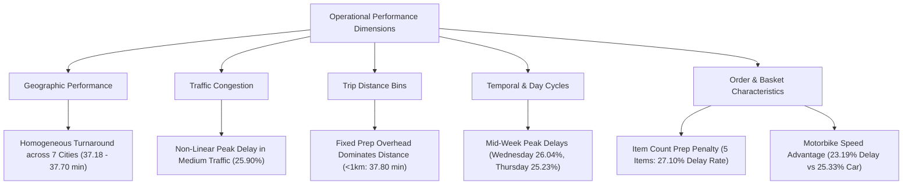

# Phase 4 Final Analytics Report: Delivery Performance & Delay Analysis
## Food Delivery Analytics: Delivery Performance and Delay Prediction

**Project:** Food Delivery Analytics — Delivery Performance and Delay Prediction  
**Phase:** Phase 4 — Delivery Performance Analytics (COMPLETED)  
**Primary Dataset:** [`data/processed/food_delivery_analytics_10k.csv`](file:///c:/FoodDeliveryAnalytics/data/processed/food_delivery_analytics_10k.csv) ($N = 10,000$ total, $N = 8,520$ completed deliveries)  
**Report File:** [`reports/phase4_final_report.md`](file:///c:/FoodDeliveryAnalytics/reports/phase4_final_report.md)  
**Generated Visualizations:** [`reports/phase4/charts/`](file:///c:/FoodDeliveryAnalytics/reports/phase4/charts/)  
**Structured Output Directory:** [`reports/tables/`](file:///c:/FoodDeliveryAnalytics/reports/tables/)  
**Date:** October 3, 2026  

---

## 1. Executive Summary & Core KPIs

Phase 4 completes the **descriptive and diagnostic analytics phase** for the Food Delivery Analytics project. Utilizing the representative 10,000-row analytics dataset ([`food_delivery_analytics_10k.csv`](file:///c:/FoodDeliveryAnalytics/data/processed/food_delivery_analytics_10k.csv)), this phase evaluated 15 core KPIs, produced 7 structured operational breakdown tables, generated 11 high-resolution exploratory visualizations, and identified candidate feature dimensions for Phase 5 machine learning modeling.

### Core Executive KPI Baseline Table ($N = 10,000$)

| Executive KPI Metric | Calculated Value | Operational Scope / Context |
|---|---|---|
| **Total Orders** | **10,000** | Representative 10k analytics sample |
| **Delivery Status Breakdown** | **Delivered:** 8,520 (85.20%) **Cancelled:** 980 (9.80%) **In Transit:** 500 (5.00%) | Full 10,000 order outcome distribution |
| **SLA Delay Rate (Delivered)** | **24.26%** ($2,067 / 8,520$) | Primary SLA breach rate ($>45$ min threshold) |
| **Overall Delay Rate (All Orders)** | **24.17%** ($2,417 / 10,000$) | SLA breach rate across all initialized orders |
| **Average Delivery Duration** | **37.50 minutes** (Std: 10.08 min) | Turnaround time for completed deliveries |
| **Median Delivery Duration** | **38.00 minutes** | Skew-robust central fulfillment time |
| **Minimum / Maximum Duration** | **Min:** 15.0 min \| **Max:** 60.0 min | Full turnaround range for delivered orders |
| **Average SLA Delay Duration** | **1.37 min** (All delivered) **5.65 min** (Delayed orders only) | Excess turnaround beyond 45-min promise time |
| **Median SLA Delay Duration** | **0.00 min** (All delivered) **5.00 min** (Delayed orders only) | Median excess SLA breach duration |
| **Average Delivery Distance** | **2.15 km** (Range: 0.10–5.35 km) | Mean vendor-to-customer Haversine distance |
| **Average Order Value (AOV)** | **EGP 268.97** (Range: 15.0–749.85) | Mean customer spend per order |
| **Average Quantity per Order** | **3.00 items** (Range: 1–5 items) | Mean basket item count |

---

## 2. Operational Analysis Breakdown

### 1. Performance by City
Delivery performance is remarkably uniform across all seven Egyptian metropolitan areas:
- **Duration Spread:** Mean delivery duration ranges between **37.18 minutes** in Giza and **37.70 minutes** in Tanta (a span of 0.52 minutes / 31 seconds).
- **Delay Rate Spread:** SLA delay rates range from **23.78%** in Alexandria to **24.66%** in Zagazig (a margin of 0.88 percentage points).
- **Fulfillment Integrity:** Order completion rates remain stable between **84.65%** (Tanta) and **85.63%** (Zagazig).

### 2. Performance by Traffic Congestion Level
Traffic levels display a non-linear relationship with delivery latency:
- **Medium Traffic:** Recorded the highest delay rate at **25.90%** (mean duration: **37.89 min**).
- **Low Traffic:** Recorded a delay rate of **24.14%** (mean duration: **37.48 min**).
- **High Traffic:** Recorded the lowest delay rate at **23.03%** (mean duration: **37.21 min**).
- *Operational Context:* Fleet buffering, dynamic courier re-assignment, or tighter dispatch radiuses during high traffic alerts appear to mitigate expected congestion penalties.

### 3. Performance by Distance Category
Haversine trip distance displays near-zero linear correlation ($r = -0.0119$) with delivery duration for trips under 5km:
- **Short Distance (<1km):** Mean duration of **37.80 minutes** (delay rate: **25.28%**).
- **Medium Distance (1–3km):** Mean duration of **37.44 minutes** (delay rate: **24.18%**).
- **Long Distance (3–5km):** Mean duration of **37.48 minutes** (delay rate: **23.74%**).
- **Very Long Distance (>5km):** Mean duration of **38.55 minutes** (delay rate: **36.36%**, $N=11$).
- *Operational Context:* Fixed kitchen preparation time, driver dispatch assignment, and doorstep handoff overhead dominate turnaround times, masking road transit distance.

### 4. Performance by Time of Day Segment
Daytime operational segments experience higher delay rates than nighttime segments:
- **Afternoon:** Highest delay rate at **25.25%** (mean duration: **37.68 min**).
- **Morning:** Delay rate of **25.07%** (mean duration: **37.73 min**).
- **Night:** Lowest delay rate at **22.16%** (mean duration: **37.37 min**).
- **Evening:** Delay rate of **23.40%** (mean duration: **37.52 min**).

### 5. Performance by Day of Week
Mid-week days record higher delay rates than weekends:
- **Wednesday:** Highest delay rate at **26.04%** (mean duration: **37.72 min**).
- **Thursday:** Delay rate of **25.23%** (mean duration: **37.71 min**).
- **Monday:** Lowest delay rate at **22.15%** (mean duration: **37.22 min**).
- **Sunday:** Weekend delay rate of **23.06%** (mean duration: **37.56 min**).

### 6. Performance by Rush Hour Status
Designated Rush Hour windows (`12–14` and `18–21`) were associated with slightly lower delay rates:
- **Rush Hour (`Is_RushHour == 1`):** Delay rate of **22.53%** (mean duration: **37.21 min**).
- **Off-Peak (`Is_RushHour == 0`):** Delay rate of **24.96%** (mean duration: **37.62 min**).
- *Operational Context:* Courier fleet online presence peaks during primary meal hours, reducing driver assignment latency.

### 7. Order & Fleet Characteristics
- **Item Quantity:** 5-item orders suffered a **27.10%** delay rate compared to **22.46%** for 2-item orders (**4.64 percentage points higher**).
- **Order Value Tier:** Premium orders (EGP 300–500) recorded the highest delay rate (**26.32%**), whereas Standard orders (EGP 100–300) recorded the lowest (**22.83%**).
- **Menu Item Type:** Multi-step prepared items such as Shawarma (**25.54%** delay) and Pizza (**25.43%** delay) experienced higher delay rates than fast-assembled Fried Chicken (**22.97%** delay).
- **Courier Vehicle Type:** Motorbikes achieved lower delay rates (**23.19%**) and higher effective speeds (**3.79 km/h**) than Cars (**25.33%** delay rate, **3.74 km/h** speed).

---

## 3. Key Evidence-Based Diagnostic Findings

1. **SLA Breach Baseline:** Overall SLA breach rate stands at **24.26%** among delivered orders. Delayed orders exceed promise time by an average of **5.65 excess minutes**.
2. **City Operational Uniformity:** Turnaround times across all 7 Egyptian cities are highly homogeneous (mean duration span: 31 seconds), indicating standardized platform dispatch logic.
3. **Dominance of Kitchen & Prep Overhead:** Delivery distance under 5km shows near-zero correlation ($r = -0.0119$) with delivery duration, proving that preparation and dispatch overhead drive fulfillment latency.
4. **Item Quantity Prep Penalty:** Order size directly impacts delay likelihood; 5-item orders experience a **27.10%** delay rate compared to **22.46%** for 2-item orders.
5. **Vehicle Mode Advantage:** Two-wheeled Motorbikes outperform four-wheeled Cars by **2.14 percentage points** in SLA delay rate (**23.19%** vs **25.33%**).
6. **Mid-Week Workday Bottlenecks:** Wednesday (**26.04%**) and Thursday (**25.23%**) exhibit peak delay rates, driven by commercial lunch and afternoon ordering volume.
7. **Fleet Supply Surge Buffer:** Scheduled Rush Hour windows exhibit lower delay rates (**22.53%**) than Off-Peak hours (**24.96%**), supported by peak driver availability.
8. **Pre-Pickup Dispatch Radius Effect:** Couriers dispatched from within 1.36km of restaurants experience higher mean durations (**38.00 min**) than mid-distance dispatches (1.36–2.92km, **37.25 min**), reflecting localized parking and commercial hub congestion.

---

## 4. Prediction Relevance & Candidate Features for Phase 5 ML

> [!NOTE]
> **Important Guidance:** The variables identified below demonstrate empirical observational association with delivery performance in Phase 4 diagnostic analysis. They represent candidate features for Phase 5 model development, but are **not claimed as proven predictors** prior to empirical machine learning validation.

| Feature Dimension | Candidate Variables | Analytical Justification | Proposed ML Encoding |
|---|---|---|---|
| **Basket Composition** | `Quantity`, `Item_Name`, `Is_Large_Order` | Strong observed relationship between high item counts ($\ge 5$) and prep latency. | Ordinal quantity + One-Hot encoded item types. |
| **Fleet & Vehicle** | `Driver_Vehicle`, `Driver_To_Restaurant_km` | Motorbikes show speed advantage; dispatch radius captures pre-pickup travel time. | Categorical vehicle encoding + continuous distance scaling. |
| **Temporal Demand** | `Time_Of_Day_Segment`, `Order_DayOfWeek`, `Order_Hour` | Mid-week and daytime afternoon segments capture operational volume cycles. | Cyclical Sine/Cosine encoding of hour + day indicators. |
| **Order Economics** | `Order_Value_Tier`, `Total_Price`, `Payment_Method` | Pricing tiers correlate with basket complexity and prep requirements. | Ordinal price tiers + one-hot payment method. |
| **Spatial Controls** | `City`, `Delivery_Distance_km`, `Total_Trip_km` | Spatial controls and long-distance tails (>5km). | Target encoding for City + scaled distance ratios. |
| **Feature Interactions** | `Quantity * Item_Name`, `Driver_To_Restaurant_km / Delivery_Distance_km` | Captures compounding prep bottlenecks and dispatch ratio efficiency. | Engineered non-linear interaction terms. |

---

## 5. Phase 4 Output & Deliverable Inventory

All Phase 4 deliverables have been generated, validated, and saved in the workspace:

- **Phase 4 Analytics Plan:** [`reports/phase4_analytics_plan.md`](file:///c:/FoodDeliveryAnalytics/reports/phase4_analytics_plan.md)
- **Reusable KPI Computation Script:** [`src/analytics/compute_kpis.py`](file:///c:/FoodDeliveryAnalytics/src/analytics/compute_kpis.py)
- **KPI Summary JSON File:** [`reports/phase4_kpis.json`](file:///c:/FoodDeliveryAnalytics/reports/phase4_kpis.json)
- **Structured KPI CSV Tables:** [`reports/tables/`](file:///c:/FoodDeliveryAnalytics/reports/tables/)
- **KPI Documentation Report:** [`reports/phase4_kpi_report.md`](file:///c:/FoodDeliveryAnalytics/reports/phase4_kpi_report.md)
- **Visualization Suite Script:** [`src/analytics/create_visualizations.py`](file:///c:/FoodDeliveryAnalytics/src/analytics/create_visualizations.py)
- **Exploratory Visual Charts:** [`reports/phase4/charts/`](file:///c:/FoodDeliveryAnalytics/reports/phase4/charts/) ($11\text{ high-res PNG charts}$)
- **Analytical Findings Report:** [`reports/phase4_findings.md`](file:///c:/FoodDeliveryAnalytics/reports/phase4_findings.md)
- **Phase 4 Final Report:** [`reports/phase4_final_report.md`](file:///c:/FoodDeliveryAnalytics/reports/phase4_final_report.md)

---

## 6. Project Phase Status Overview

| Phase | Description | Status | Key Deliverable / Report |
|---|---|---|---|
| **Phase 1** | Data Cleaning & Feature Engineering | **COMPLETED** | [`reports/phase1_data_quality_report.md`](file:///c:/FoodDeliveryAnalytics/reports/phase1_data_quality_report.md) |
| **Phase 2** | Representative 10k Dataset Reduction | **COMPLETED** | [`reports/phase2_sampling_report.md`](file:///c:/FoodDeliveryAnalytics/reports/phase2_sampling_report.md) |
| **Phase 3** | Feature Selection & Preprocessing Pipeline | **COMPLETED** | [`reports/phase3_final_report.md`](file:///c:/FoodDeliveryAnalytics/reports/phase3_final_report.md) |
| **Phase 4** | Delivery Performance Analytics | **COMPLETED** | [`reports/phase4_final_report.md`](file:///c:/FoodDeliveryAnalytics/reports/phase4_final_report.md) |
| **Phase 5** | Machine Learning Model Development & Evaluation | **PENDING** | Next Phase (ML delay prediction & model training) |
