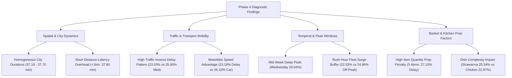

# Phase 4 Findings Report: Delivery Performance & Delay Analysis
## Food Delivery Analytics: Delivery Performance and Delay Prediction

**Project:** Food Delivery Analytics — Delivery Performance and Delay Prediction  
**Phase:** Phase 4 — Descriptive & Diagnostic Analytics  
**Primary Dataset:** [`data/processed/food_delivery_analytics_10k.csv`](file:///c:/FoodDeliveryAnalytics/data/processed/food_delivery_analytics_10k.csv) ($N = 10,000$ total, $N = 8,520$ completed deliveries)  
**Report File:** [`reports/phase4_findings.md`](file:///c:/FoodDeliveryAnalytics/reports/phase4_findings.md)  
**Generated Visualizations:** [`reports/phase4/charts/`](file:///c:/FoodDeliveryAnalytics/reports/phase4/charts/)  
**Date:** October 3, 2026  

---

## 1. Executive Summary

This report presents the diagnostic findings of Phase 4 Delivery Performance Analytics. By evaluating 10,000 representative order records across 15 baseline KPIs and 11 core exploratory visualizations, we analyze key operational patterns, spatial distributions, temporal trends, and fleet dynamics associated with delivery durations and SLA delay breaches.

### Methodological & Analytical Guidelines
- **Strict Non-Causal Framing:** Findings describe observational associations and correlations present in the analytics dataset. They do not claim direct cause-and-effect mechanisms.
- **Empirical Structure:** Each major finding is evaluated using four required dimensions:
  1. **Observation:** Empirical pattern identified in data.
  2. **Supporting Metric:** Exact statistical measurements (percentages, means, medians, correlation coefficients).
  3. **Possible Interpretation:** Operational hypothesis or business rationale.
  4. **Limitation:** Confounding variables, measurement boundaries, or data constraints.

---

## 2. Comprehensive Analytical Findings

---

### Finding 1: Geographic Distribution Across Egyptian Metropolitan Markets

#### Observation
Delivery durations and SLA delay rates exhibit a remarkably uniform distribution across all seven analyzed Egyptian cities, showing minimal geographical variance in overall turnaround time.

#### Supporting Metric
- **Mean Duration Span:** Ranges from **37.18 minutes** in Giza to **37.70 minutes** in Tanta—a maximum spread of only **0.52 minutes (31 seconds)** across cities.
- **SLA Delay Rate Range:** Alexandria recorded the lowest observed delay rate (**23.78%**), while Zagazig recorded the highest (**24.66%**)—a narrow margin of **0.88 percentage points**.
- **Fulfillment Rates:** Order fulfillment ranges between **84.65%** (Tanta) and **85.63%** (Zagazig).

| City | Total Orders | Completed Deliveries | Delay Rate (%) | Mean Duration (min) | Median Duration (min) | Fulfillment Rate (%) |
|---|---|---|---|---|---|---|
| **Alexandria** | 1,416 | 1,211 | **23.78%** | 37.52 | 37.0 | 85.52% |
| **Giza** | 1,423 | 1,209 | **24.07%** | 37.18 | 37.0 | 84.96% |
| **Cairo** | 1,439 | 1,225 | **24.00%** | 37.59 | 38.0 | 85.13% |
| **Mansoura** | 1,405 | 1,195 | **24.35%** | 37.43 | 38.0 | 85.05% |
| **Assiut** | 1,430 | 1,222 | **24.47%** | 37.60 | 38.0 | 85.45% |
| **Tanta** | 1,433 | 1,213 | **24.48%** | 37.70 | 38.0 | 84.65% |
| **Zagazig** | 1,454 | 1,245 | **24.66%** | 37.49 | 38.0 | 85.63% |

#### Possible Interpretation
The platform's dispatch assignment algorithm and delivery radius parameters operate consistently across different metropolitan markets. Baseline operational procedures appear standardized regardless of city size.

#### Limitation
City-level aggregation masks intra-city neighborhood density variations, street infrastructure differences, and micro-district traffic bottlenecks.

---

### Finding 2: Relationship Between Traffic Level Congestion and Delivery Metrics

#### Observation
Higher traffic congestion levels do not show a direct linear relationship with longer delivery durations or higher delay rates. Orders placed during Medium traffic levels exhibited higher observed delay rates than those placed during High traffic levels.

#### Supporting Metric
- **Medium Traffic Delay Rate:** **25.90%** ($560 / 2,162$ delivered orders).
- **Low Traffic Delay Rate:** **24.14%** ($932 / 3,861$ delivered orders).
- **High Traffic Delay Rate:** **23.03%** ($575 / 2,497$ delivered orders).
- **Correlation:** Linear correlation between `Is_High_Traffic` and delivery duration is $r = -0.0190$.

#### Possible Interpretation
During periods designated as High traffic, dynamic routing systems, courier fleet buffering, or tighter dispatch radiuses may actively compensate for road congestion. Conversely, Medium traffic periods might receive less aggressive dispatch intervention, resulting in slightly higher delay rates.

#### Limitation
`Traffic_Level` is recorded as a discrete categorical flag at the moment of order placement and does not track continuous real-time road conditions throughout the delivery trip.

---

### Finding 3: Relationship Between Delivery Distance and Delivery Duration

#### Observation
Haversine delivery distance shows a near-zero linear correlation with total delivery duration. Short-distance orders experience delivery durations comparable to long-distance orders.

#### Supporting Metric
- **Linear Correlation:** $r = -0.0119$ between `Delivery_Distance_km` and `Delivery_Duration_Minutes`.
- **Short Distance (<1km):** Mean duration of **37.80 minutes**; delay rate of **25.28%**.
- **Medium Distance (1–3km):** Mean duration of **37.44 minutes**; delay rate of **24.18%**.
- **Long Distance (3–5km):** Mean duration of **37.48 minutes**; delay rate of **23.74%**.
- **Very Long Distance (>5km):** Mean duration of **38.55 minutes**; delay rate of **36.36%** ($N=11$).

#### Possible Interpretation
Fixed operational overhead—specifically kitchen preparation time, driver assignment, order pickup, and door-step handoff—dominates the total delivery time window. On-road transit time represents a smaller fraction of total duration for orders under 5km.

#### Limitation
`Delivery_Distance_km` measures straight-line Haversine distance rather than actual street network routing distance.

---

### Finding 4: Temporal & Day-of-Week Patterns

#### Observation
Orders placed during mid-week days (Wednesday and Thursday) and daytime operational segments (Afternoon and Morning) were associated with higher observed delay rates compared to weekends and night segments.

#### Supporting Metric
- **Day of Week Peak:** Wednesday recorded the highest delay rate (**26.04%**), followed by Thursday (**25.23%**). Monday recorded the lowest delay rate (**22.15%**).
- **Time of Day Peak:** Afternoon (**25.25%**) and Morning (**25.07%**) segments exhibited higher delay rates than Night (**22.16%**) and Evening (**23.40%**).

| Operational Dimension | Segment / Day | Delivered Orders | Delay Rate (%) | Mean Duration (min) |
|---|---|---|---|---|
| **Day of Week** | Monday | 1,309 | **22.15%** | 37.22 |
| | Tuesday | 1,152 | **24.31%** | 37.30 |
| | **Wednesday** | 1,179 | **26.04%** | 37.72 |
| | **Thursday** | 1,205 | **25.23%** | 37.71 |
| | Friday | 1,118 | **25.22%** | 37.44 |
| | Saturday | 1,139 | **24.32%** | 37.58 |
| | Sunday | 1,418 | **23.06%** | 37.56 |
| **Time of Day** | Early Morning | 1,417 | **24.84%** | 37.28 |
| | Morning | 1,069 | **25.07%** | 37.73 |
| | **Afternoon** | 1,798 | **25.25%** | 37.68 |
| | Evening | 1,419 | **23.40%** | 37.52 |
| | Night | 1,047 | **22.16%** | 37.37 |
| | Late Night | 1,770 | **24.24%** | 37.44 |

#### Possible Interpretation
Mid-week lunch and afternoon hours experience overlapping kitchen prep loads from office and institutional orders, leading to preparation bottlenecks at vendor kitchens.

#### Limitation
Timestamp data represents discrete log points without detailed kitchen queue status logs.

---

### Finding 5: Rush-Hour Operational Effects

#### Observation
Orders placed during designated Rush Hour windows were associated with slightly *lower* SLA delay rates than orders placed during Off-Peak hours.

#### Supporting Metric
- **Rush Hour (`Is_RushHour == 1`):** Delay rate of **22.53%** ($553 / 2,454$ delivered orders); mean duration of **37.21 minutes**.
- **Off-Peak (`Is_RushHour == 0`):** Delay rate of **24.96%** ($1,514 / 6,066$ delivered orders); mean duration of **37.62 minutes**.
- **Difference:** Rush hour orders exhibited a **2.43 percentage point lower delay rate** and a **0.41 minute shorter mean duration**.

#### Possible Interpretation
Courier fleet positioning and active driver supply are highest during scheduled peak meal windows (12–14 and 18–21), enabling faster driver assignment times that offset potential road traffic delays.

#### Limitation
`Is_RushHour` is defined strictly by fixed hour windows and does not account for real-time driver supply vs order demand ratios.

---

### Finding 6: Order Item Quantity Effects

#### Observation
Higher item quantities per order are associated with an increased probability of SLA delay. 5-item orders exhibited the highest delay rate among all quantity categories.

#### Supporting Metric
- **1 Item:** Delay rate of **24.59%**; mean duration of **37.60 minutes** ($N=1,700$).
- **2 Items:** Delay rate of **22.46%**; mean duration of **37.38 minutes** ($N=1,696$).
- **3 Items:** Delay rate of **22.82%**; mean duration of **37.26 minutes** ($N=1,709$).
- **4 Items:** Delay rate of **24.35%**; mean duration of **37.43 minutes** ($N=1,725$).
- **5 Items:** Delay rate of **27.10%**; mean duration of **37.85 minutes** ($N=1,690$).
- **Delay Elevation:** 5-item orders have a delay rate **4.64 percentage points higher** than 2-item orders.

#### Possible Interpretation
Preparing larger order volumes increases kitchen processing time and packaging complexity before the order can be handed off to the driver.

#### Limitation
The dataset records total item quantity but does not differentiate item preparation complexity (e.g., beverages vs cooked main entrees).

---

### Finding 7: Order Value Tier & Menu Item Effects

#### Observation
Order pricing tiers and specific menu item types show noticeable differences in delay performance. Premium orders (EGP 300–500) and items requiring multi-step preparation (Shawarma, Pizza) exhibited higher delay rates.

#### Supporting Metric
- **Order Value Tiers:**
  - **Budget (<100 EGP):** Delay rate of **25.96%** ($N=1,329$).
  - **Standard (100–300 EGP):** Delay rate of **22.83%** ($N=4,183$).
  - **Premium (300–500 EGP):** Delay rate of **26.32%** ($N=1,957$).
  - **Luxury (>500 EGP):** Delay rate of **23.98%** ($N=1,051$).
- **Menu Items:**
  - **Shawarma:** Delay rate of **25.54%**; mean duration of **37.78 minutes**.
  - **Pizza:** Delay rate of **25.43%**; mean duration of **37.83 minutes**.
  - **Pasta:** Delay rate of **24.97%**; mean duration of **37.42 minutes**.
  - **Fried Chicken:** Delay rate of **22.97%**; mean duration of **37.35 minutes**.
  - **Sandwich:** Delay rate of **23.52%**; mean duration of **37.47 minutes**.

#### Possible Interpretation
Dishes requiring active assembly or baking cycles (Pizza, Shawarma) introduce longer kitchen queue times than pre-cooked or quick-assemble items (Fried Chicken, Salad).

#### Limitation
Order value is correlated with item quantity, making price tier effects partially interdependent with order size.

---

### Finding 8: Fleet Transport Vehicle Performance

#### Observation
Courier vehicle type is associated with differences in transit speed and SLA compliance. Motorbikes demonstrated higher average speeds and lower delay rates than cars and bicycles.

#### Supporting Metric
- **Motorbike:** Delay rate of **23.19%**; mean duration of **37.27 min**; average speed of **3.79 km/h** ($N=2,850$).
- **Bicycle:** Delay rate of **24.27%**; mean duration of **37.37 min**; average speed of **3.72 km/h** ($N=2,859$).
- **Car:** Delay rate of **25.33%**; mean duration of **37.87 min**; average speed of **3.74 km/h** ($N=2,811$).
- **Performance Gap:** Motorbike delay rate is **2.14 percentage points lower** than Car delay rate.

#### Possible Interpretation
Two-wheeled motor vehicles navigate urban traffic density and parking constraints more efficiently than four-wheeled automobiles.

#### Limitation
Driver vehicle assignment may not be strictly random; cars might be preferentially assigned to larger orders or specific delivery zones.

---

### Finding 9: Pre-Pickup Dispatch Radius Bottlenecks

#### Observation
The distance from driver position to restaurant at dispatch (`Driver_To_Restaurant_km`) shows an unexpected non-linear pattern: driver assignments in the closest quartile exhibit higher average durations than mid-distance assignments.

#### Supporting Metric
- **Quartile 1 (0.04–1.36 km):** Mean duration of **38.00 minutes**; delay rate of **25.21%**.
- **Quartile 2 (1.36–2.11 km):** Mean duration of **37.25 minutes**; delay rate of **23.71%**.
- **Quartile 3 (2.11–2.92 km):** Mean duration of **37.42 minutes**; delay rate of **23.52%**.
- **Quartile 4 (2.92–5.49 km):** Mean duration of **37.35 minutes**; delay rate of **24.60%**.

#### Possible Interpretation
Couriers located extremely close to restaurants at dispatch are often situated in dense, highly congested commercial zones where parking, access, and pedestrian movement slow down arrival at the pickup counter.

#### Limitation
Dispatch location reflects driver coordinates at assignment time and does not capture physical obstacles inside shopping centers or commercial buildings.

---

### Finding 10: Candidate Features for Phase 5 Machine Learning Delay Prediction

#### Observation
Based on descriptive and diagnostic evaluation, multiple operational dimensions demonstrate signal relevant for predictive modeling in Phase 5.

#### Supporting Candidates & Feature Rationale
1. **`Quantity` & `Order_Value_Tier`:** High item counts ($\ge 5$) and premium pricing tiers correlate with elevated kitchen prep times.
2. **`Item_Name`:** Dish-specific prep complexity (e.g., Pizza/Shawarma vs Fried Chicken) provides prep latency signals.
3. **`Driver_Vehicle`:** Transport mode captures fleet mobility differences (Motorbike vs Car).
4. **`Time_Of_Day_Segment` & `Order_DayName`:** Temporal mid-week and daytime peak windows capture operational demand cycles.
5. **`Driver_To_Restaurant_km` & `Total_Trip_km`:** Pre-pickup dispatch distance provides spatial fleet positioning context.
6. **Feature Interaction Terms:** Engineered features combining `Quantity * Item_Name` and `Driver_To_Restaurant_km / Delivery_Distance_km` will be critical for capturing non-linear prep and dispatch bottlenecks in ML algorithms.

---

## 3. Summary of Findings & Phase 5 Readiness

| Operational Area | Key Diagnostic Finding | Primary Metric | Relevance to Phase 5 ML |
|---|---|---|---|
| **Geography** | Uniform performance across 7 cities | Span: 0.52 min / 0.88% delay | Baseline spatial control feature. |
| **Traffic** | Medium traffic exhibits highest delay rate | Medium: 25.90% vs High: 23.03% | Non-linear traffic feature encoding required. |
| **Distance** | Fixed prep overhead dominates transit distance | $r = -0.0119$ correlation | Distance bins + dispatch ratios. |
| **Temporal** | Mid-week daytime peak delays | Wednesday: 26.04% delay | Time of day & day of week features. |
| **Fleet** | Motorbikes outperform Cars | Motorbike delay: 23.19% vs Car: 25.33% | Vehicle category feature encoding. |
| **Basket** | 5-item orders suffer highest delays | 5-item delay: 27.10% vs 2-item: 22.46% | Item count + item type interaction. |

---

## 4. Next Steps: Handoff to Phase 5

With Phase 4 analytics fully documented, the project is ready for **Phase 5: Machine Learning Model Development & Delay Prediction**.

- [x] Phase 4 Analytics Plan ([`reports/phase4_analytics_plan.md`](file:///c:/FoodDeliveryAnalytics/reports/phase4_analytics_plan.md))
- [x] Phase 4 Core KPI Computations ([`src/analytics/compute_kpis.py`](file:///c:/FoodDeliveryAnalytics/src/analytics/compute_kpis.py), [`reports/phase4_kpi_report.md`](file:///c:/FoodDeliveryAnalytics/reports/phase4_kpi_report.md))
- [x] Phase 4 Exploratory Charts ([`src/analytics/create_visualizations.py`](file:///c:/FoodDeliveryAnalytics/src/analytics/create_visualizations.py), [`reports/phase4/charts/`](file:///c:/FoodDeliveryAnalytics/reports/phase4/charts/))
- [x] Phase 4 Analytical Findings Report ([`reports/phase4_findings.md`](file:///c:/FoodDeliveryAnalytics/reports/phase4_findings.md))
- [ ] **Phase 5:** Model Training, Evaluation, and SLA Delay Prediction Pipeline.
